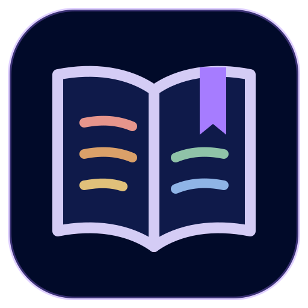

<p align="center"></p>

<h1 align="center">Studium</h1>

<p align="center"><a href="README.md">🇺🇸 Read in English</a></p>

<p align="center">
Um caderno de estudos para matérias, apostilas, PDFs, anotações, flashcards e cursos da faculdade.<br>
Um app para <b>Linux</b> e <b>Android</b>, 100% offline, com os dados guardados em arquivos Markdown comuns.
</p>

> [!NOTE]
> **O Studium é um app de estudos em desenvolvimento.** Já funciona no Linux e no Android, mas
> telas e formatos de arquivo ainda podem mudar. Ainda não há versão empacotada: compile a partir
> do código (veja abaixo).

## Por quê

- **Offline.** Sem conta, sem nuvem, sem rastreamento. O app Android nem pede a permissão de
  Internet.
- **Seus arquivos.** Tudo é um arquivo Markdown com um pequeno cabeçalho YAML numa pasta que você
  escolhe. Abra em qualquer editor, faça backup copiando a pasta, use git se quiser.
- **O mesmo app em todo lugar.** A mesma interface React roda no Electron (Linux) e no Capacitor
  (Android), com barra lateral em telas largas e barra inferior no celular.
- **Sincronização pelo cabo USB.** O app do PC copia as mudanças para o celular e de volta pelo
  `adb`, arquivo por arquivo, e mostra os conflitos lado a lado para você escolher.
- **Inglês e português do Brasil**, seguindo o idioma do aparelho por padrão.

## Funcionalidades

| Área | O que faz |
| --- | --- |
| **Hoje** | As aulas de hoje (do horário da faculdade), os flashcards para revisar e o capítulo onde você parou. |
| **Estudos pessoais** | Área própria, que abre numa página inicial com as matérias numa árvore como a do Obsidian (grupos → matérias → submatérias) ou em cards por grupo, com capa; cada uma com "com minhas palavras" (Feynman), materiais, PDFs, exercícios, links com tipos (documentação, vídeo, artigo…), anotações e um Workbench de projetos práticos com guias. |
| **Navegação** | Um painel lateral que fica ao lado do que está aberto: fixados, recentes e a árvore, onde anotações e matérias são renomeadas no lugar (F2), movidas (menu ou arrastando), duplicadas, fixadas ou excluídas, com os `[[links]]` atualizados ao renomear. Voltar e avançar (Ctrl+Alt+← / →, botões laterais do mouse), paleta de comandos (Ctrl+P) que mostra cada atalho, e a lista completa no F1. Veja [docs/UX.md](docs/UX.md). |
| **Materiais** | Apostilas importadas de arquivos `.md` ou coladas, lidas capítulo por capítulo, com marcação de lido e "você parou aqui". |
| **Anotações** | Por material, capítulo ou PDF, com etiquetas, filtros e ordens; `[[links]]` entre anotações, materiais e matérias, com backlinks. |
| **Flashcards** | Escritos dentro das anotações com as marcas do Spaced Repetition do Obsidian (`::`, `:::`, `?`, `??`), revisados com um SM-2 simplificado por matéria ou tudo de uma vez. |
| **Escola** | Cursos com semestres; matérias com professor, sala, horário, aulas, trabalhos com arquivos, provas, média ponderada, a nota que ainda falta e as faltas contra o limite. |
| **Editor** | Markdown como no Obsidian com pré-visualização ao vivo: `[[links]]` e `![[incorporações]]`, imagens coladas ou arrastadas, callouts, `$fórmulas$` (KaTeX), diagramas ```` ```mermaid ````, notas de rodapé, `%%comentários%%`, tabelas que se alinham sozinhas, menu "/", localizar e substituir, sumário, modelos, propriedades, Ctrl+O para abrir qualquer nota e Ctrl+P para comandos. Exporta qualquer nota para PDF. |
| **Desenhos** | Desenhos do [Excalidraw](https://excalidraw.com) dentro das notas (`/desenho` ou `![[nome.excalidraw]]`), no formato do plugin Excalidraw do Obsidian. |
| **Aparência** | Claro/escuro, esquemas de cores (Studium, Minimal, Catppuccin, Nord, Gruvbox, Atom One), cor de destaque, fontes, tamanho do texto e da interface, largura da linha e seus próprios snippets CSS. |
| **Também** | Busca geral, lixeira com desfazer, backup e restauração em .zip e um atalho "Revisar cartões" no Android (segure o ícone do app). |

Os PDFs abrem no app de PDF do aparelho (no Linux, o leitor padrão); as anotações sobre um PDF ficam no Studium.

## Seus dados

```
Studium/
├── study/
│   ├── _courses/          um arquivo por curso
│   ├── _groups.md         ordem dos grupos pessoais
│   ├── _covers/           capas dos grupos
│   └── <matéria>/
│       ├── subject.md     título, grupo, matéria-mãe; o corpo é "com minhas palavras"
│       ├── materials/     apostilas, lidas por capítulo
│       ├── notes/         anotações (os flashcards ficam aqui)
│       ├── pdfs/
│       ├── exercises/
│       ├── workbench/     projetos práticos
│       ├── assignments/   só matérias da escola
│       ├── exams/
│       └── links.md
├── drawings/              *.excalidraw.md
├── attachments/
├── templates/
├── .trash/
└── .studium/              configurações e estado da sincronização
```

O formato dos arquivos é o mesmo da área de Estudos do
[Polaris](https://github.com/Leonardo-Sponton/polaris), de onde o Studium saiu: uma pasta `study/`
do Polaris pode ser copiada como está para a pasta do Studium (com `attachments/` e `drawings/`
também, se as notas incorporam imagens ou desenhos).

## Instalar e compilar

Precisa do Node.js 22 ou mais novo.

```sh
git clone https://github.com/Leonardo-Sponton/studium.git
cd studium
npm install
npm test            # testes (Vitest)
npm run electron    # roda o app de PC
```

Se o `npm run electron` disser que o Electron não foi instalado (versões novas do npm podem pular
scripts de instalação), rode uma vez `node node_modules/electron/install.js`.

**Pacote Linux**

```sh
npm run dist                          # release/: AppImage e tar.gz
cd packaging/arch && makepkg -si      # pacote do Arch Linux
```

**Android** (Android 8.0 ou mais novo; precisa do Android SDK e do JDK 21)

```sh
npm run android                       # compila a parte web e copia para android/
cd android && ./gradlew assembleDebug
adb install app/build/outputs/apk/debug/app-debug.apk
```

Na primeira vez o app Android pede "Acesso a todos os arquivos", para ler o que o PC copia pelo
cabo para `Documents/Studium`.

**Sincronização USB:** ligue a depuração USB no celular, conecte o cabo e abra *Sincronizar* no
app do PC. O `adb` é procurado no `PATH` ou em `~/Android/Sdk/platform-tools`.

## Dados de exemplo

Para ver todas as telas preenchidas:

```sh
node tools/sample-data.mjs add ~/StudiumDemo --lang pt   # português
node tools/sample-data.mjs add ~/StudiumDemo             # inglês
node tools/sample-data.mjs remove ~/StudiumDemo          # tira só os arquivos de exemplo
```

## Tecnologias

TypeScript, React e Vite · editor CodeMirror 6 com pré-visualização do Markdown · Electron
(Linux) · Capacitor com um pequeno plugin Java para acessar arquivos (Android) · Vitest. Como o app
foi separado do Polaris está em [docs/ARCHITECTURE.md](docs/ARCHITECTURE.md).

## Créditos

O editor segue o Markdown do [Obsidian](https://obsidian.md) e usa ideias, não código, destes
plugins: Spaced Repetition (marcas dos cartões), Advanced Tables e Recent Files (Tony Grosinger) e
Remember cursor position (Dmitry Savosh). A edição de tabelas é feita pela
[md-advanced-tables](https://github.com/tgrosinger/md-advanced-tables) (MIT); fórmulas pelo
[KaTeX](https://katex.org) e diagramas pelo [Mermaid](https://mermaid.js.org). Os desenhos usam o
editor do [Excalidraw](https://github.com/excalidraw/excalidraw) (MIT) e o formato de arquivo do
plugin Excalidraw do Obsidian (Zsolt Viczián); a Aparência segue as configurações do Obsidian e o
plugin Style Settings (mgmeyers), também só como ideia. Os esquemas de cores seguem
[Catppuccin](https://catppuccin.com), [Nord](https://www.nordtheme.com),
[Gruvbox](https://github.com/morhetz/gruvbox) e Atom One (todos MIT). Cada biblioteca incluída e
sua licença estão em [THIRD_PARTY_NOTICES.md](THIRD_PARTY_NOTICES.md) e no app (Configurações →
Licenças de código aberto).

## Licença

[MIT](LICENSE) © Leonardo Sponton.
